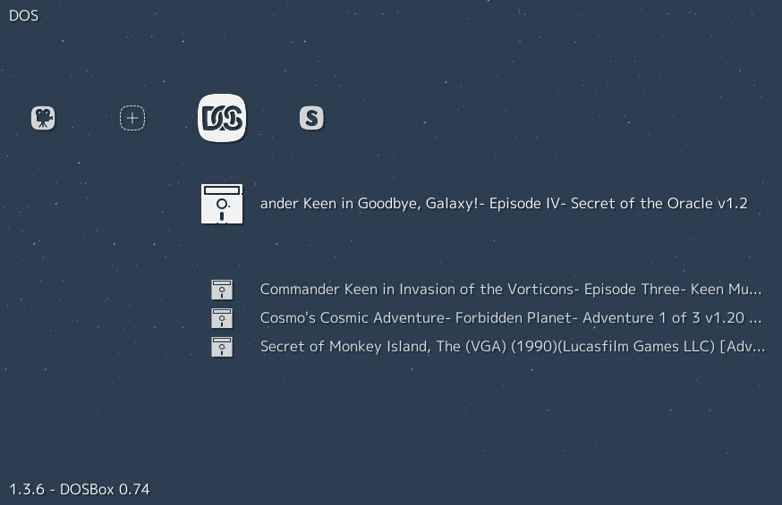

# libretro-database-dos

Builds [libretro-database's DOS.dat](https://github.com/libretro/libretro-database/blob/master/dat/DOS.dat) from the [Total DOS Collection](http://www.totaldoscollection.org) to allow running DOS games directly from [RetroArch](https://www.libretro.com/).



## Build

```
git submodule update --init
npm install
npm run build
```

The output is written to [libretro-database/dat/DOS.dat](libretro-database/dat/DOS.dat). The Total DOS Collection's `tdc_daily.dat` is downloaded again whenever there's a newer copy.

## Data

The files in [lib](lib) adjust the output:

- `acceptableExtensions.json` and `diskImageExtensions.json` are the files that can identify a game, preferring executables over disk images
- `rejectGames.json` and `rejectTags.json` skip entries that aren't games, like cracks, trainers and manuals
- `genres.json` maps the Total DOS Collection genres to libretro's genres
- `developers.json` renames developers to match libretro-database, after the `Inc` and `Ltd` suffixes are removed
- `additions.json` adds games, replacing the Total DOS Collection's entry when the CRC matches

## Test

```
npm test
```
